# acmevault
[](https://goreportcard.com/report/github.com/soerenschneider/acmevault)


## Features

🔐 Issues certificates from Let's Encrypt using the DNS01 challenge on Route53<br/>
⏰ Automatically renews certificates before they expire<br/>
🔌 Stores all data inside Vault and thus decouples from clients<br/>
✍️ Signed container images and release binaries, built reproducibly<br/>

## Problem Statement

Rolling out TLS encryption shouldn't need to be pitched anymore (even for internal services). Using the DNS01 ACME challenge is proven and allows issuing certs for machines that are not publicly routable. On the other hand, you need to have access to either highly-privileged or narrowly-scoped credentials of your DNS provider to solve these DNS01 challenges.

In the case of Route53, if you don't want to end up creating dozens of hosted zones, one for each of your subdomains, you're at risk of leaking highly-privileged IAM credentials.

Acmevault requests short-lived IAM credentials for Route53 and uses them to perform DNS01 challenges for the configured domains and writes the issued X509 certificates to Hashicorp Vault's K/V secret store - only readable by the appropriate AppRole.

Clients read their certificates directly from Vault, see [consuming certificates](docs/vault.md#consuming-certificates).

## Overview


## Prerequisites

- A Vault instance with a K/V version 2 secrets engine, an AWS secrets engine role for Route53 and an auth method for acmevault. See [Vault setup](docs/vault.md) for details and example policies.
- A Route53 hosted zone for the domains you want to issue certificates for.

## Installation

### Docker / Podman
```shell
$ git clone https://github.com/soerenschneider/acmevault
$ cd acmevault
$ docker run -v $(pwd)/contrib:/config ghcr.io/soerenschneider/acmevault -config /config/config.yaml
```

### Kubernetes
Acmevault supports Vault's Kubernetes auth method. Store the configuration in a ConfigMap and run a single replica:
```yaml
apiVersion: apps/v1
kind: Deployment
metadata:
  name: acmevault
spec:
  replicas: 1
  selector:
    matchLabels:
      app: acmevault
  template:
    metadata:
      labels:
        app: acmevault
    spec:
      serviceAccountName: acmevault
      containers:
        - name: acmevault
          image: ghcr.io/soerenschneider/acmevault:<version>
          args: ["-config", "/config/config.yaml"]
          env:
            - name: ACMEVAULT_VAULT_AUTH_METHOD
              value: kubernetes
            - name: ACMEVAULT_VAULT_K8S_ROLE_ID
              value: acmevault
          volumeMounts:
            - name: config
              mountPath: /config
      volumes:
        - name: config
          configMap:
            name: acmevault
```

### Binaries
Download a prebuilt binary from the [releases section](https://github.com/soerenschneider/acmevault/releases) for your system.

### From Source
As a prerequisite, you need to have [Go](https://go.dev/dl/) and `make` installed. The build automatically uses the exact Go version from `go.mod`, downloading it if necessary.
```shell
$ git clone https://github.com/soerenschneider/acmevault
$ cd acmevault
$ make build
```

## Verifying Releases

Container images and release binaries are signed in CI using [cosign](https://github.com/sigstore/cosign) keyless signing, so no public key needs to be distributed.

### Container Images
```shell
$ cosign verify ghcr.io/soerenschneider/acmevault:<version> \
    --certificate-identity-regexp 'https://github.com/soerenschneider/acmevault/.github/workflows/.*' \
    --certificate-oidc-issuer https://token.actions.githubusercontent.com
```

### Binaries
Download the binary, `checksum.sha256` and `checksum.sha256.sigstore.json` from the release, then verify the signature of the checksum file and the checksum of the binary:
```shell
$ cosign verify-blob checksum.sha256 \
    --bundle checksum.sha256.sigstore.json \
    --certificate-identity-regexp 'https://github.com/soerenschneider/acmevault/.github/workflows/.*' \
    --certificate-oidc-issuer https://token.actions.githubusercontent.com
$ sha256sum --ignore-missing -c checksum.sha256
```

### Reproducible Builds
Binaries are built reproducibly: building the same tag with the same Go version yields byte-identical binaries, independent of the machine or directory. To check this for yourself, check out a release tag and compare the result against the published checksums:
```shell
$ git checkout <version>
$ make release VERSION=<version>
$ cat builds/checksum.sha256
```

`make verify-reproducible` builds all release binaries twice from separate checkouts and compares them.

### Older Releases
Releases up to and including v1.15.0 are not signed with cosign and were not built reproducibly. Their checksum file is signed with [signify](https://man.openbsd.org/signify) instead (`checksum.sha256.sig`).

## Configuration
Acmevault is configured using a YAML file passed via `-config` or `ACMEVAULT_CONFIG_FILE`. All options can be overridden using environment variables prefixed with `ACMEVAULT_`. See the [configuration section](docs/configuration.md) for examples and configuration reference.

## Observability
See the [metrics section](docs/metrics.md) for an overview of exposed metrics.

## Security
Acmevault never holds long-lived DNS provider credentials: it requests short-lived Route53 credentials from Vault on demand, and each client can be restricted to reading only its own certificate via Vault policies.

See [SECURITY.md](SECURITY.md) for how to report vulnerabilities.

## Development
```shell
$ make tests               # run unit tests with race detector and coverage
$ golangci-lint run        # lint
$ make pre-commit-init     # install pre-commit hooks (fmt, tests, lint, conventional commits)
```

Commit messages follow [Conventional Commits](https://www.conventionalcommits.org/). Releases and the changelog are created automatically by [release-please](https://github.com/googleapis/release-please) from the commit history.

## Changelog
See the full changelog [here](CHANGELOG.md)
